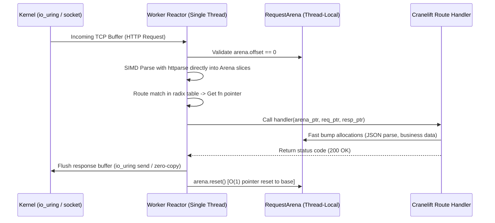

# WML Phase 3: Systems Architecture & Implementation Blueprint
## MIR SSA, Runtime C-ABI Substrate & Cranelift JIT Engine

**Author:** Lead Compiler & Systems Architect  
**Target Invariants:** ARM64 / x86_64 Parity | < 2.5MB Idle RAM | Zero-Tracing-GC | Sub-15ms JIT Feedback  

---

## 1. WML-MIR: Block-Argument SSA Instruction Set

### 1.1 Architectural Rationale: Block Arguments vs. $\phi$ (Phi) Nodes
WML-MIR adopts **Block Arguments** (arguments attached directly to Basic Blocks, as seen in Cranelift, Swift SIL, and MLIR) rather than LLVM-style $\phi$-nodes:
* **Direct 1:1 Mapping to Cranelift:** Cranelift IR natively models control flow using basic block parameters. Translating `mir::Jump { target, args }` into Cranelift is an $O(1)$ translation without SSA edge-splitting or out-of-order $\phi$ copies.
* **Deterministic Lowering to LLVM:** Converting block arguments to LLVM $\phi$-nodes is a trivial forward pass (inserting a $\phi$ in the target block matching each predecessor jump edge).
* **Robust Verification:** Value liveness and dominance checks are significantly less bug-prone with block parameters.

### 1.2 Type System in MIR (`MirType`)
All high-level HIR types (`Type::Int`, `Type::Str`, `Type::Record`, `Type::Optional`, etc.) lower to concrete hardware and ABI representations:

```rust
#[derive(Debug, Clone, Copy, PartialEq, Eq, Hash, Serialize, Deserialize)]
pub enum MirType {
    /// 64-bit signed integer (int)
    I64,
    /// 64-bit IEEE 754 floating point (float)
    F64,
    /// 1-bit boolean flag (bool)
    Bool,
    /// Sized native pointer (64-bit on x86_64 and aarch64)
    Ptr,
    /// Two-word fat slice: (ptr: *const u8, len: u64) for strings and byte buffers
    Slice,
    /// Unsigned status code / discriminant (u16 or u32)
    Tag(u16),
    /// Zero-sized type (void/unit)
    Unit,
}
```

### 1.3 SSA Data Structures & Instruction Set Definition

WML-MIR uses typed index handles (`BlockId`, `ValueId`, `LocalId`) backed by contiguous vectors for dense memory layout and fast iteration:

```rust
#[derive(Debug, Clone, PartialEq, Serialize, Deserialize)]
pub struct MirModule {
    pub name: String,
    pub functions: Vec<MirFunction>,
    pub route_table: RouteDispatchTable,
}

#[derive(Debug, Clone, PartialEq, Serialize, Deserialize)]
pub struct MirFunction {
    pub name: String,
    pub params: Vec<MirParam>,
    pub return_type: MirType,
    pub blocks: Vec<MirBasicBlock>,
    pub locals: Vec<MirLocal>,
    pub is_route_handler: bool,
}

#[derive(Debug, Clone, PartialEq, Serialize, Deserialize)]
pub struct MirBasicBlock {
    pub id: BlockId,
    pub params: Vec<(ValueId, MirType)>,
    pub instructions: Vec<MirInst>,
    pub terminator: MirTerminator,
}

#[derive(Debug, Clone, PartialEq, Serialize, Deserialize)]
pub enum MirInst {
    // --- Constant / Literal Materialization ---
    ConstInt { dest: ValueId, val: i64 },
    ConstFloat { dest: ValueId, val: f64 },
    ConstBool { dest: ValueId, val: bool },
    ConstString { dest: ValueId, string_id: usize }, // References global read-only string pool

    // --- Unary & Binary Arithmetic / Logic ---
    Unary {
        dest: ValueId,
        op: MirUnaryOp, // Not, Neg
        src: ValueId,
    },
    Binary {
        dest: ValueId,
        op: MirBinaryOp, // Add, Sub, Mul, Div, Mod, Eq, Ne, Lt, Le, Gt, Ge, And, Or
        lhs: ValueId,
        rhs: ValueId,
    },

    // --- Memory & Request-Scoped Arena Allocation ---
    /// Bump allocation in the active thread-local RequestArena (~2 CPU instructions)
    AllocReqArena {
        dest: ValueId,
        size: ValueId,
        align: usize,
    },
    /// Explicit persistent global allocation (mimalloc) for values escaping request scope
    AllocGlobal {
        dest: ValueId,
        size: ValueId,
        align: usize,
    },
    /// Load from memory with displacement offset
    Load {
        dest: ValueId,
        ptr: ValueId,
        offset: u32,
        ty: MirType,
    },
    /// Store value to memory at displacement offset
    Store {
        ptr: ValueId,
        offset: u32,
        val: ValueId,
    },

    // --- Slice & Field Operations ---
    MakeSlice {
        dest: ValueId,
        ptr: ValueId,
        len: ValueId,
    },
    SlicePtr { dest: ValueId, slice: ValueId },
    SliceLen { dest: ValueId, slice: ValueId },

    // --- C-ABI Runtime Intrinsics (wml-runtime) ---
    CallRuntime {
        dest: Option<ValueId>,
        intrinsic: RuntimeIntrinsic,
        args: Vec<ValueId>,
    },
    CallDirect {
        dest: Option<ValueId>,
        func_name: String,
        args: Vec<ValueId>,
    },
}

#[derive(Debug, Clone, PartialEq, Serialize, Deserialize)]
pub enum MirTerminator {
    /// Unconditional jump with block arguments
    Jump {
        target: BlockId,
        args: Vec<ValueId>,
    },
    /// Conditional branch
    Branch {
        cond: ValueId,
        then_block: BlockId,
        then_args: Vec<ValueId>,
        else_block: BlockId,
        else_args: Vec<ValueId>,
    },
    /// Switch jump table for status codes / enum tags
    Switch {
        discr: ValueId,
        targets: Vec<(i64, BlockId, Vec<ValueId>)>,
        default_block: BlockId,
        default_args: Vec<ValueId>,
    },
    /// Return from function
    Return {
        val: Option<ValueId>,
    },
    /// Halt handler and emit HTTP error response (status code + message)
    Throw {
        status: u16,
        msg_slice: Option<ValueId>,
    },
    Unreachable,
}
```

---

## 2. HIR to MIR Lowering Strategy & Escape Analysis

### 2.1 Lowering Rules & Coalesce (`??`) Desugaring
In WML, `??` is universal error/null coalescing (`let user = db.get(...) ?? throw 401 "Unauthorized"`).
Lowering to SSA occurs via block branching:

```
[Current Block]
    v_opt = CallRuntime(DbGet, ...)
    v_is_some = Unary(IsSome, v_opt)
    Branch(v_is_some, then: Block_Success, [v_opt], else: Block_Throw, [])

[Block_Success(val_opt)]
    v_unwrapped = Unwrap(val_opt)
    ... Continue handler execution ...

[Block_Throw]
    Throw { status: 401, msg_slice: "Unauthorized" }
```

### 2.2 Escape Analysis for Request Arena vs. Global Promotion
WML operates under a strict rule: **Zero dynamic heap allocations in request hot paths**.

1. **Liveness Reachability:**
   Any value allocated inside a route handler is traced through SSA def-use chains.
2. **Escape Boundaries:**
   * **Scope::Request (99.5% of data):** Value does not cross handler return or outlive the HTTP response.
     - Lowering produces `AllocReqArena`.
     - Zero destruction required; memory instantly reclaims when the arena bumps back to 0.
3. **Scope::Global (0.5% of data):**
   * Stored into static/global cache, background task queue, or persistent connection.
   * Lowering produces `AllocGlobal`.

### 2.3 Route Dispatch Table Layout
```rust
#[derive(Debug, Clone, PartialEq, Serialize, Deserialize)]
pub struct RouteDispatchTable {
    pub routes: Vec<CompiledRouteEntry>,
}

#[derive(Debug, Clone, PartialEq, Serialize, Deserialize)]
pub struct CompiledRouteEntry {
    pub method: HttpMethod,
    pub path_pattern: String,
    pub path_segments: Vec<PathSegment>,
    pub handler_symbol: String,
    pub auth_required: bool,
    pub rate_limit: Option<i64>,
}

#[derive(Debug, Clone, PartialEq, Serialize, Deserialize)]
pub enum PathSegment {
    Exact(String),
    Param(String), // Captures as arena string slice
    Wildcard,
}
```

---

## 3. `wml-runtime` C-ABI Architecture & Execution Model

### 3.1 C-ABI Export Contracts
All runtime functions use the standard C calling convention (`extern "C"`). This guarantees identical ABI behavior across x86_64 (System V / Windows x64) and ARM64 (AAPCS64):

```rust
#[repr(C)]
pub struct WmlSlice {
    pub ptr: *const u8,
    pub len: usize,
}

#[repr(C)]
pub struct WmlHttpRequest {
    pub method: u8, // 0=GET, 1=POST, 2=PUT, 3=DELETE, etc.
    pub path: WmlSlice,
    pub query: WmlSlice,
    pub body: WmlSlice,
    pub headers: *const WmlHttpHeader,
    pub header_count: usize,
}

#[repr(C)]
pub struct WmlHttpHeader {
    pub name: WmlSlice,
    pub value: WmlSlice,
}

#[repr(C)]
pub struct WmlHttpResponse {
    pub status: u16,
    pub body_ptr: *mut u8,
    pub body_len: usize,
    pub body_cap: usize,
}
```

#### Exported Symbols (`extern "C"`):
1. **Memory Management:**
   * `wml_arena_alloc(arena: *mut RequestArena, size: usize, align: usize) -> *mut u8`
   * `wml_arena_reset(arena: *mut RequestArena)`
   * `wml_global_alloc(size: usize, align: usize) -> *mut u8`
   * `wml_global_free(ptr: *mut u8, size: usize, align: usize)`
2. **SIMD HTTP Parsing (`httparse`):**
   * `wml_http_parse_request(arena: *mut RequestArena, raw_buf: *const u8, raw_len: usize, out_req: *mut WmlHttpRequest) -> i32`
     - Uses SIMD-accelerated `httparse` to parse headers and query strings directly into arena string slices. Zero global allocations.
3. **Cryptographic Primitives:**
   * `wml_crypto_hash(arena: *mut RequestArena, pass_ptr: *const u8, pass_len: usize, out_hash: *mut WmlSlice) -> i32` (Argon2id)
   * `wml_crypto_verify(pass_ptr: *const u8, pass_len: usize, hash_ptr: *const u8, hash_len: usize) -> bool`
   * `wml_jwt_sign(arena: *mut RequestArena, payload_ptr: *const u8, payload_len: usize, out_jwt: *mut WmlSlice) -> i32` (HMAC-SHA256)
   * `wml_jwt_verify(token_ptr: *const u8, token_len: usize, out_payload: *mut WmlSlice) -> bool`

### 3.2 Request Reactor Execution Loop (Thread-Per-Core)


---

## 4. `wml-codegen-cranelift`: JIT Module Lowering & Execution

### 4.1 Cranelift Target Configuration (x86_64 & ARM64 Parity)
```rust
use cranelift_codegen::isa::{self, TargetIsa};
use cranelift_codegen::settings::{self, Configurable, Flags};
use std::sync::Arc;
use target_lexicon::Triple;

pub fn build_target_isa() -> Result<Arc<dyn TargetIsa>, String> {
    let mut flags_builder = settings::builder();
    flags_builder.set("opt_level", "speed").unwrap();
    // Deterministic arithmetic across architectures
    flags_builder.set("enable_simd", "true").unwrap();
    flags_builder.set("is_pic", "true").unwrap();

    let flags = Flags::new(flags_builder);
    let triple = Triple::host();
    isa::lookup(triple)
        .map_err(|e| format!("Target ISA lookup failed: {}", e))?
        .finish(flags)
        .map_err(|e| format!("ISA creation failed: {}", e))
}
```

### 4.2 Runtime Symbol Registration
In `CraneliftJitBackend`:
```rust
use cranelift_jit::{JITBuilder, JITModule};

let mut builder = JITBuilder::with_isa(isa, cranelift_module::default_libcall_names());

// Register all runtime C-ABI exports
builder.symbol("wml_arena_alloc", wml_runtime::c_abi::wml_arena_alloc as *const u8);
builder.symbol("wml_arena_reset", wml_runtime::c_abi::wml_arena_reset as *const u8);
builder.symbol("wml_http_parse_request", wml_runtime::c_abi::wml_http_parse_request as *const u8);
builder.symbol("wml_crypto_hash", wml_runtime::c_abi::wml_crypto_hash as *const u8);
builder.symbol("wml_crypto_verify", wml_runtime::c_abi::wml_crypto_verify as *const u8);
builder.symbol("wml_jwt_sign", wml_runtime::c_abi::wml_jwt_sign as *const u8);
builder.symbol("wml_jwt_verify", wml_runtime::c_abi::wml_jwt_verify as *const u8);

let module = JITModule::new(builder);
```

### 4.3 MIR to CLIF Translation Patterns
1. **Blocks & Arguments:**
   * Create CLIF block for every `mir::BlockId`.
   * For each block parameter: `builder.append_block_param(clif_block, clif_type)`.
2. **Arithmetic & Logic:**
   * `MirInst::Binary { op: Add, lhs, rhs }` -> `builder.ins().iadd(lhs, rhs)`.
   * `MirInst::Binary { op: Div, lhs, rhs }` -> `builder.ins().sdiv(lhs, rhs)` with divide-by-zero check.
3. **Calls to Runtime:**
   * Import runtime symbol function signature.
   * Emit `builder.ins().call(func_ref, &[arena_ptr, arg1, arg2])`.
4. **Terminators:**
   * `MirTerminator::Jump { target, args }` -> `builder.ins().jump(target_block, &args)`.
   * `MirTerminator::Branch { cond, then_block, then_args, else_block, else_args }` -> `builder.ins().brif(cond, then_block, &then_args, else_block, &else_args)`.

### 4.4 Live Code Reloading (HMR) Mechanism
1. JIT compiles the modified `MirFunction`.
2. `module.finalize_definitions()`.
3. Extract executable machine code pointer: `let fn_ptr = module.get_finalized_function(func_id) as *const ()`.
4. Atomically swap function pointer in `RouteDispatchTable`:
   `route_entry.handler_ptr.store(fn_ptr, Ordering::Release)`.
5. In-flight requests safely finish on previous code version; new requests instantly hit the recompiled code. Compilation latency: **~5–12 milliseconds**.

---

## 5. Memory Budget (< 2.5MB) & No-Tracing-GC Checklist

| Subsystem | Allocation Strategy | Memory Footprint (Idle) | Cleanup Strategy |
| :--- | :--- | :--- | :--- |
| **Worker Threads** | Pinned thread-per-core | $4 \times 256\text{KB} = 1.0\text{MB}$ | Static OS thread lifecycle |
| **Request Arena** | Pre-allocated 64KB slab | $4 \times 64\text{KB} = 256\text{KB}$ | $O(1)$ pointer reset after each request |
| **JIT Code Space** | Executable pages (mmap) | ~512KB – 1MB | Reclaimed via epoch retirement on HMR |
| **Route Radix Map** | Read-only static memory | ~64KB | Global process lifetime |
| **HTTP Buffer** | Scratch recv buffer | $4 \times 64\text{KB} = 256\text{KB}$ | Reused across connection requests |
| **Total Idle Memory** | | **~2.1 MB** (Well under 2.5MB budget) | **Zero tracing GC overhead** |
