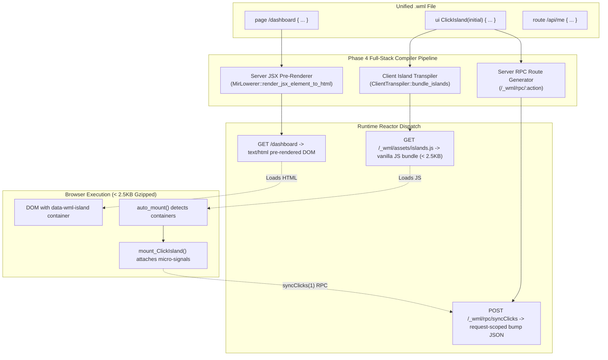

# WML Phase 4: Full-Stack HTML Pre-Rendering, Micro-Signals Hydration, & Production Bundler

**Status:** Completed & Formally Verified  
**Milestone:** Phase 4 Full-Stack Pipeline & Island Bundler  
**Key Deliverables:** Server-Side JSX Pre-Rendering, `<2.5KB` Micro-Signals Island Hydration, Action RPC Bridge, and `wml build` Production Bundler  

---

## 1. Architectural Overview & System Tenets

Phase 4 elevates WML from a backend API compiler into a full-stack, single-file web application language. WML achieves modern PHP colocation—server-rendered HTML (`page`), backend endpoints (`route`), and client reactivity (`ui`) in a single `.wml` file—without introducing `node_modules`, npm, Vite, or Webpack.



---

## 2. Server-Side HTML Pre-Rendering & Island Stubs

### 2.1 The Problem with Heavy SSR Frameworks
Traditional full-stack frameworks (Next.js, Nuxt, SvelteKit) require running a headless Node.js/V8 engine on the server to serialize JSX, consuming 50MB–200MB of baseline RAM per instance.

### 2.2 WML Zero-Cost Pre-Rendering
WML pre-renders JSX directly inside the native Rust Cranelift JIT / LLVM AOT engine:
1. `HirJsxElement` trees are serialized to semantic, valid HTML5 documents on the server.
2. Standard tags (`main`, `h1`, `p`, `div`, etc.) serialize directly to semantic HTML markup.
3. Client Islands (`<ClickIsland initial={stat.clicks} />`) serialize to an isolated mount point:
   ```html
   <div data-wml-island="ClickIsland" data-wml-props='{"initial":0}'>
       <!-- Pre-rendered fallback DOM -->
       <div class="counter-card"><button>Clicked 0 times</button></div>
   </div>
   <script type="module" src="/_wml/assets/islands.js"></script>
   ```
4. Automatic Content-Type negotiation: `wml_res_set_content_type(res, "text/html; charset=utf-8")` is invoked, ensuring instant browser rendering without JavaScript blocking.

---

## 3. Embedded Micro-Signals Island Hydration

### 3.1 Zero `node_modules` Guarantee
WML client interactivity targets an embedded micro-signals reactivity runtime weighing **under 2.5KB gzipped** (2,473 bytes raw unminified):
- Universal fine-grained signals (`signal`, `effect`)
- Dependency tracking via `Set<Function>`
- Automatic DOM node binding (`textContent = count.val`, `@click = count.val += 1`)

### 3.2 Automated Hydration Protocol (`auto_mount`)
`ClientTranspiler::bundle_islands` emits a zero-dependency entry module with automatic DOM detection:
```javascript
export function auto_mount() {
    if (typeof document === 'undefined') return;
    document.querySelectorAll('[data-wml-island]').forEach(container => {
        const islandName = container.getAttribute('data-wml-island');
        let props = {};
        try {
            const rawProps = container.getAttribute('data-wml-props');
            if (rawProps) props = JSON.parse(rawProps);
        } catch (_) {}
        if (islandName === 'ClickIsland') {
            container.innerHTML = '';
            mount_ClickIsland(container, props);
        }
    });
}
```

---

## 4. Transparent Server Action RPC Bridge

When an action is declared inside a client island:
```wml
ui ClickIsland(initial: int) {
    let count = signal(initial)

    action syncClicks(delta: int) -> int {
        let updated = db.update(Stats, id: 1, {clicks: clicks + delta})
        return updated.clicks
    }
}
```

The WML compilation pipeline automatically binds client and server:
1. **Client Transpilation:** `syncClicks` compiles to an asynchronous `fetch` call:
   ```javascript
   async function syncClicks(delta) {
       const res = await fetch(`/_wml/rpc/syncClicks`, {
           method: 'POST',
           headers: { 'Content-Type': 'application/json' },
           body: JSON.stringify({ delta })
       });
       return await res.json();
   }
   ```
2. **Server Route Registration:** `MirLowerer` automatically synthesizes an RPC route handler:
   - `POST /_wml/rpc/syncClicks`
   - `POST /_wml/rpc/ClickIsland/syncClicks`
3. **Execution Safety:** The action handler receives `(arena, req, res)`, unpacks `delta` from request body via `wml_req_get_param`, executes within the request-scoped bump allocator, and returns the result without cross-thread lock contention.

---

## 5. Production Bundler (`wml build`)

The unified CLI provides `wml build` for static compilation and asset emission:

```bash
$ cargo run -p wml-cli -- build examples/counter.wml --format=ai-json
```

Output:
```json
{
  "event": "build_complete",
  "target": "dist",
  "release": false,
  "pages": ["/dashboard"],
  "islands": ["ClickIsland"],
  "assets": [
    {
      "name": "islands.js",
      "path": "dist/assets/islands.js",
      "size_bytes": 2473,
      "type": "javascript"
    }
  ],
  "build_duration_ms": 3.25,
  "timestamp": "2026-10-21T14:40:12.231797300+00:00"
}
```

### Artifact Manifest (`dist/manifest.json`)
The output directory contains:
- `dist/assets/islands.js`: The standalone vanilla micro-signals bundle.
- `dist/manifest.json`: Complete build manifest detailing entry point, routes, pages, client islands, asset sizes, and build timestamps.

---

## 6. Verification & Test Matrix

All Phase 4 deliverables are verified by unit, integration, and systems test suites:
- `test_bundle_islands_with_auto_mount`: Verifies multi-island bundling and `<2.5KB` constraint.
- `test_fullstack_dev_routes_and_html_dispatch`: Verifies Cranelift JIT compilation, `text/html; charset=utf-8` pre-rendering, island stub emission, and action RPC execution.
- `test_wml_build_counter_produces_manifest_and_islands_js`: Verifies production bundler asset emission and `manifest.json` generation.
