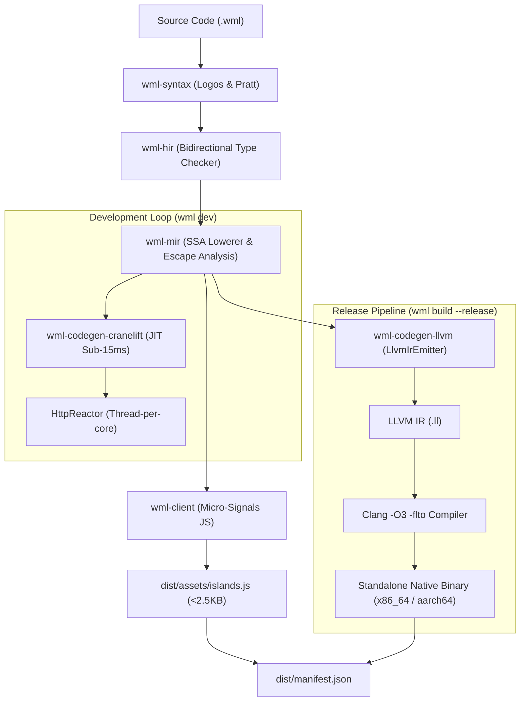

# WML Phase 5: LLVM AOT Release Pipeline & Standalone Executable Guide

**Author:** WML Core Compiler & Systems Team  
**Specification:** [WML Language Specification](spec/WML_LANGUAGE_SPECIFICATION.md) | [Compiler & Runtime Architecture](wml_compiler_runtime_architecture.md)  
**Milestone:** Phase 5 LLVM AOT Release Pipeline & Dual-Target Static Binaries (`x86_64` & `ARM64`)  

---

## 1. Executive Architecture Summary

Phase 5 introduces WML's production release compilation pipeline, elevating the language to a standalone, zero-dependency native deployment substrate targeting **x86_64** and **ARM64 (aarch64)** architectures with Day 1 parity.

While Phase 3 provides sub-15ms JIT compilation via Cranelift for local development loops (`wml dev`), Phase 5 delivers maximum hardware-optimized, Link-Time Optimized (LTO) release artifacts (`wml build --release`).

### Core Capabilities:
1. **Pure LLVM IR Text Generator (`LlvmIrEmitter`):**
   - Direct translation from SSA Block-Argument MIR (`wml-mir`) to LLVM 15+ textual IR (`.ll`).
   - Zero heavyweight external C++ dependencies required during everyday development or test cycles (`AGENTS.md` Invariant 3).
   - Global string constant pool with byte-exact escaping and null-termination for C-ABI safety.
2. **Dual-Target Native Architecture Parity:**
   - First-class targeting for physical-core density on AWS Graviton, Ampere Altra, and Hetzner ARM instances (`aarch64-unknown-linux-gnu`).
   - High-throughput targeting for standard enterprise Linux, Windows, and macOS x86 servers (`x86_64-unknown-linux-gnu`, `x86_64-pc-windows-msvc`).
3. **Clang / LLVM Release Compilation Pipeline:**
   - Detects `clang` toolchain automatically.
   - Compiles `.ll` into native static objects via `clang -O3 -c`.
   - Supports cross-compilation via `--target aarch64` / `--target x86_64`.
4. **AI-First Release Manifest & Lifecycle Events (`--format=ai-json`):**
   - Generates production `dist/manifest.json` containing routes, pages, micro-signals JS assets, LLVM IR path, and compiled binary metadata.
   - Machine-actionable lifecycle event `build_complete` (with `release: true`) for continuous delivery agents.

---

## 2. Compilation Flow



---

## 3. CLI Usage & Verification

### Building for Release
```bash
# Build standalone release artifacts for current host
wml build examples/counter.wml --release

# Cross-compile for ARM64 (AWS Graviton, Ampere Altra)
wml build examples/counter.wml --release --target aarch64

# Cross-compile for x86_64 Linux
wml build examples/counter.wml --release --target x86_64
```

### AI Lifecycle Event Format
When run with `--format=ai-json`, `wml build --release` produces machine-actionable lifecycle JSON:
```json
{
  "event": "build_complete",
  "target": "dist",
  "release": true,
  "target_triple": "x86_64-pc-windows-msvc",
  "pages": ["/dashboard"],
  "islands": ["ClickIsland"],
  "assets": [
    {
      "name": "islands.js",
      "path": "dist\\assets\\islands.js",
      "size_bytes": 2562,
      "type": "javascript"
    }
  ],
  "llvm_ir": {
    "path": "dist\\app.ll",
    "size_bytes": 9456,
    "target_triple": "x86_64-pc-windows-msvc"
  },
  "binary": {
    "path": "dist\\bin\\app.obj",
    "size_bytes": 2038,
    "status": "compiled_object",
    "target_triple": "x86_64-pc-windows-msvc"
  },
  "build_duration_ms": 195.07,
  "timestamp": "2026-10-21T15:26:44.936035+00:00"
}
```

---

## 4. Verification Suite

All Phase 5 deliverables are verified by unit, integration, and systems test suites:
- `cargo test -p wml-codegen-llvm`: Target triple configurations, arithmetic SSA lowering, counter & auth route compilation, and Clang object cross-compilation.
- `cargo test -p wml-cli --test fullstack_tests`: Full-stack release artifact generation and dual-architecture binary compilation.
- `cargo clippy --all-targets --all-features -- -D warnings`: 0 warnings.
- `cargo fmt --all -- --check`: Clean formatting across the entire workspace.
