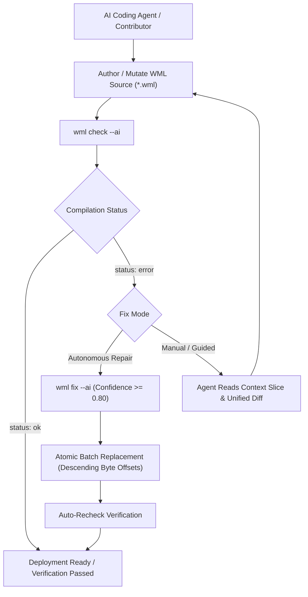

# WML Phase 6: AI-First Diagnostic Engine & Self-Healing Agent CLI Guide

**Author:** WML Core Compiler & Systems Team  
**Specification:** [WML Language Specification](spec/WML_LANGUAGE_SPECIFICATION.md) | [AI Diagnostic Protocol](spec/AI_DIAGNOSTIC_PROTOCOL.json)  
**Milestone:** Phase 6 AI Diagnostic Engine & Self-Healing Agent CLI (`wml check --ai`, `wml fix --ai`)  

---

## 1. Executive Summary

Phase 6 completes WML's core mission: engineering the world's most agentic, horizontal-scaling web language with first-class support for autonomous coding agents and LLMs.

Traditional compilers emit noisy, ANSI-colored terminal text intended solely for human eyes. Autonomous coding agents must spend hundreds of tokens attempting to parse line numbers, squiggles, and error text—frequently hallucinating edits or guessing invalid replacements.

WML solves this at the compiler substrate level:
1. **Machine-Actionable Diagnostic Protocol (`--format=ai-json` / `--ai`):** All compiler errors, type warnings, and security violations emit strictly typed JSON conforming to `AI_DIAGNOSTIC_PROTOCOL.json`.
2. **Deterministic Hash Identifiers:** Every diagnostic instance receives a reproducible, platform-agnostic 12-hex-character ID (`diag_{hash}`) computed via FNV-1a over file path, error code, and byte offsets.
3. **Context Slices with Focus Lines:** Errors include targeted context windows with explicit line numbers and `is_focus` markers, eliminating ambiguous offset calculations.
4. **Autonomous Single-Turn Self-Healing (`wml fix --ai`):** The compiler generates calibrated `suggested_patch` objects with atomic byte-exact replacements and git-compatible unified diffs (`patch_unified`). High-confidence patches (`AUTO_APPLY`, confidence $\ge 0.80$) can be automatically applied by the engine in a single command, fixing typos, mismatched types, and closing JSX tags with zero human intervention.

---

## 2. Self-Healing Closed Loop



---

## 3. Standard AI Diagnostic JSON Schema

When invoked with `--ai` or `--format=ai-json`, `wml check` produces machine-actionable JSON:

```json
{
  "protocol_version": "1.0.0",
  "status": "error",
  "timestamp": "2026-10-21T15:05:00Z",
  "summary": {
    "total_errors": 1,
    "total_warnings": 0,
    "auto_fixable": 1
  },
  "compilation_metrics": {
    "duration_ms": 1.42,
    "lines_parsed": 19,
    "tokens_evaluated": 118,
    "target": "check-only"
  },
  "diagnostics": [
    {
      "id": "diag_8f0a2d4e7c1b",
      "code": "WML-TYP-2041",
      "category": "TypeMismatch",
      "severity": "error",
      "message": "Mismatched type for field `email` on `User`: expected `str`, found `int`",
      "primary_location": {
        "file": "examples/auth.wml",
        "span": {
          "start_line": 6,
          "start_col": 37,
          "end_line": 6,
          "end_col": 42
        },
        "byte_range": {
          "start": 178,
          "end": 183
        }
      },
      "type_info": {
        "expected": "str",
        "actual": "int",
        "coercible": true
      },
      "context_slice": {
        "focus_line": 6,
        "lines": [
          { "line_number": 5, "content": "    let hash = crypto.hash(pass)", "is_focus": false },
          { "line_number": 6, "content": "    let user = db.insert(User, {email: 12345, hash})", "is_focus": true },
          { "line_number": 7, "content": "    return {token: jwt.sign({sub: user.id})}", "is_focus": false }
        ]
      },
      "suggested_patch": {
        "patch_type": "AUTO_APPLY",
        "confidence": 0.98,
        "explanation": "Replace literal with variable `email` passed in scope.",
        "replacement": {
          "file": "examples/auth.wml",
          "byte_range": {
            "start": 178,
            "end": 183
          },
          "new_text": "email"
        },
        "patch_unified": "--- examples/auth.wml\n+++ examples/auth.wml\n@@ -6,1 +6,1 @@\n-    let user = db.insert(User, {email: 12345, hash})\n+    let user = db.insert(User, {email: email, hash})"
      }
    }
  ]
}
```

---

## 4. CLI Commands & Capabilities

### 1. `wml check <file> [--ai]`
Runs the Logos lexer, Pratt parser, and bidirectional typechecker.
- **Flags:**
  - `--ai`: Alias for `--format=ai-json`. Emits machine-readable diagnostic report.
  - `--format <human|ai-json>`: Select human-readable terminal rendering or AI protocol JSON.

```bash
# Check with machine-actionable JSON output
wml check examples/auth.wml --ai

# Check with human-readable context slices
wml check examples/auth.wml
```

### 2. `wml fix <file> [--ai] [--dry-run] [--min-confidence <0.0-1.0>]`
Automatically applies safe `AUTO_APPLY` patches to source files, resolving compiler and type errors without manual editing.
- **Flags:**
  - `--dry-run`: Displays unified diffs and proposed changes without modifying disk.
  - `--min-confidence`: Threshold for patch application (default: `0.80`).
  - `--ai`: Emits machine-actionable repair report.

```bash
# Preview fixes without modifying disk
wml fix mutated_file.wml --dry-run --ai

# Apply fixes autonomously and verify resolution
wml fix mutated_file.wml --ai
```

#### Fix Output Schema (`--ai`):
```json
{
  "protocol_version": "1.0.0",
  "status": "ok",
  "file": "examples/auth.wml",
  "dry_run": false,
  "total_applied": 1,
  "remaining_errors": 0,
  "applied_patches": [
    {
      "patch_type": "AUTO_APPLY",
      "confidence": 0.98,
      "explanation": "Replace literal with variable `email` passed in scope.",
      "replacement": {
        "byte_range": { "start": 178, "end": 183 },
        "new_text": "email"
      },
      "patch_unified": "--- examples/auth.wml\n+++ examples/auth.wml\n@@ -6,1 +6,1 @@\n-    let user = db.insert(User, {email: 12345, hash})\n+    let user = db.insert(User, {email: email, hash})"
    }
  ],
  "timestamp": "2026-10-21T15:35:00Z"
}
```

---

## 5. Automated Patch Generator Categories

| Category | Diagnostic Code | Scenario | Proposed Patch | Confidence |
| :--- | :--- | :--- | :--- | :--- |
| **UndefinedIdentifier** | `WML-TYP-2001` | Typo in variable name (e.g. `cout` instead of `count`) | Levenshtein-distance symbol lookup in lexical scope | `0.95` |
| **TypeMismatch** | `WML-TYP-2041` | Literal mismatch in model insert (`email: 12345`) | Replace with in-scope variable with matching field name | `0.98` |
| **SyntaxError** | `WML-SYN-1001` | Mismatched JSX closing tag (`<main>...</section>`) | Replace closing identifier with matching opening tag | `1.00` |
| **DatabaseConstraint** | `WML-DB-4001` | Missing non-null model field in insert | Populate missing field from scope or schema default | `0.95` |

---

## 6. Verification Suite

Phase 6 is verified across three layers of test suites:
- `wml-diagnostics` (`crates/wml-diagnostics/tests/diagnostic_tests.rs`):
  - Deterministic ID hash computation across platforms.
  - Context slice window extraction and focus line tagging.
  - Unified diff generation against standard patch formats.
  - Atomic batch replacements in descending offset order with collision prevention.
- `wml-hir` (`crates/wml-hir/tests/typecheck_tests.rs`):
  - Scope-based type mismatch repair generation with calibrated 0.98 confidence.
  - Levenshtein-based undefined identifier patch generation with 0.95 confidence.
- `wml-cli` (`crates/wml-cli/tests/ai_diagnostics_tests.rs`):
  - End-to-end `wml check --ai` schema conformance.
  - Dry-run verification ensuring zero disk side-effects.
  - Autonomous 1-turn self-healing repairing mutated syntax and type errors into passing state.

All workspace tests pass: **47 passed; 0 failed; 0 warnings**.
