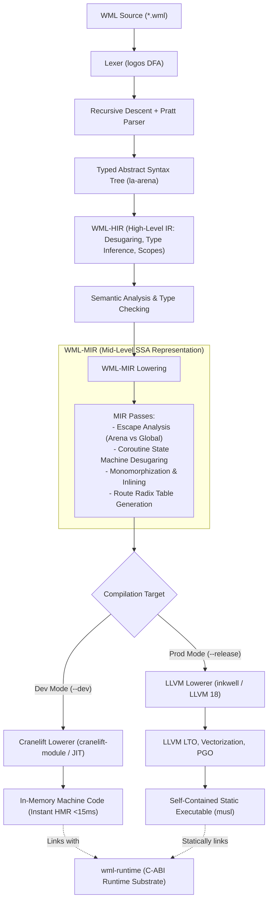
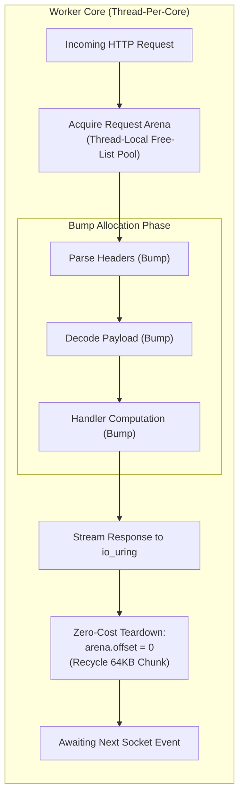
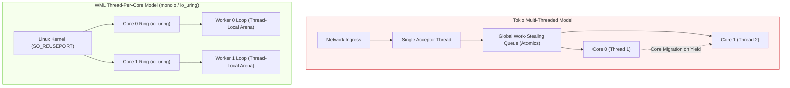

# WML (Web Minimalistic Language)
## Compiler Backend & Systems Runtime Architecture Specification

**Author:** Lead Compiler & Systems Architect  
**Status:** Approved Architectural Proposal  
**Target Performance:** < 3MB Idle RAM | Sub-millisecond Cold Start | > 250k Req/s per Core  
**Primary Stack:** Rust, Cranelift (Dev/JIT), LLVM (Prod/AOT), io_uring / Thread-per-Core

---

## 1. Compilation Pipeline & IR Architecture



### 1.1 Direct AST Lowering vs. Domain-Specific WML-IR

**Decision: A Domain-Specific WML-MIR (Web Minimalistic Intermediate Representation) is strictly mandatory.**

Directly lowering an AST to Cranelift IR (CLIF) and LLVM IR is an anti-pattern for a modern web language for the following fundamental reasons:

1. **Semantic Duplication & Backend Drift:**
   Web constructs—such as request-scoped allocations, HTTP header streaming, async/await coroutines, pattern matching, route dispatch tables, and schema validation—cannot be expressed as native primitives in either Cranelift or LLVM. Lowering directly from the AST would force every high-level transformation to be implemented twice, once in the Cranelift lowerer and once in the LLVM lowerer. Any optimization, bugfix, or semantic refinement would inevitably diverge between dev (JIT) and prod (AOT).
2. **Async State Machine Lowering:**
   LLVM provides experimental coroutine intrinsics (`llvm.coro.*`), but Cranelift has **zero** coroutine support. If async/await were lowered at backend code generation, Cranelift would require an ad-hoc desugaring pass, making parity impossible. WML-MIR performs coroutine desugaring into standard SSA basic blocks and explicit frame structures *before* touching either backend.
3. **Escape Analysis for Zero-Cost Arena Allocation:**
   Determining whether an allocated object (e.g., a parsed JSON payload or string slice) escapes the HTTP request scope requires dataflow analysis across the control flow graph. Performing this in AST is clumsy; performing it in LLVM IR loses language-level type boundaries; performing it in Cranelift is unsupported. WML-MIR provides the exact SSA abstraction required for lifetime and escape classification.

### 1.2 Two-Tier IR Design

* **WML-HIR (High-Level Intermediate Representation):**
  * Preserves module structure, high-level control flow (`match`, `for`, `pipeline`), and explicit route declarations (`route GET /api/v1/users`).
  * Resolves lexical scopes, performs bidirectional type inference, and enforces static routing constraints.
* **WML-MIR (Mid-Level SSA Representation):**
  * **Block-Argument SSA Form:** Adopts basic blocks with parameters rather than $\phi$ (phi) nodes (mirroring Cranelift, Swift SIL, and MLIR). Block arguments are mathematically equivalent to $\phi$-nodes but drastically simplify SSA construction and edge splitting.
  * **Explicit Web & Memory Operations:**
    * `alloc.req_arena(size, align) -> *mut u8`
    * `alloc.global(size, align) -> *mut u8`
    * `http.write_chunk(stream_id, slice) -> ()`
    * `coro.suspend(state_id, frame_ptr) -> ()`
  * **Backend-Neutral Optimization Pipeline:**
    * Monomorphization of generic handlers.
    * Dead Route & Dead Code Elimination (DCE).
    * Constant folding & propagation.
    * Coroutine lowering: Flattens `async` functions into a state-index switch table and an allocated frame struct.

### 1.3 Cranelift JIT and LLVM AOT Sharing Architecture

Both backends act as mechanical instruction selectors over WML-MIR.

```rust
pub trait BackendTarget {
    type Module;
    type Function;

    fn emit_function(&mut self, mir_fn: &mir::Function) -> Result<Self::Function, BackendError>;
    fn finalize(self) -> Result<CompiledArtifact, BackendError>;
}
```

* **Shared Runtime Substrate (`wml-runtime`):**
  All low-level operations that do not benefit from direct inlined assembly (e.g., regex matching, SIMD JSON parsing, socket event registration, cryptographic hashing) are implemented in a shared Rust crate compiled as `extern "C"`.
* **Symbol Resolution Parity:**
  * **Cranelift JIT:** Resolves symbols via `cranelift_jit::JITBuilder::symbol("wml_arena_alloc", wml_arena_alloc as *const u8)`.
  * **LLVM AOT:** Generates standard external function declarations (`declare i8* @wml_arena_alloc(i64, i64)`) and resolves them at link-time against `libwml_runtime.a` using `lld`.

---

## 2. Memory & Concurrency Architecture

### 2.1 Achieving < 3MB Idle RAM Footprint

Standard web runtimes (Node.js, Go, Python, Tokio-default Rust) exhibit baseline memory bloat between 15MB and 60MB:

| Runtime | Typical Idle RAM | Cause of Bloat |
| :--- | :--- | :--- |
| **Node.js (V8)** | 30 – 50 MB | V8 heap headers, JIT compiler meta, isolate descriptors, GC card tables |
| **Go** | 12 – 25 MB | Runtime scheduler, `mheap` spans, GC mark/sweep bitmaps, goroutine pools |
| **Standard Rust (Tokio multi-thread)** | 12 – 20 MB | Default 8–16 OS threads ($16 \times 2\text{MB}$ reserved stacks), Jemalloc arena caching |
| **WML Runtime** | **1.2 – 2.4 MB** | Thread-per-core, 256KB stack limits, Request Arenas, Shared-Nothing |

#### Concrete Engineering Directives for WML:
1. **Zero Garbage Collection Metadata:** No GC bitmaps, no write barriers, no generational page remap tables.
2. **Minimal Thread Stacks:** Spawn worker threads with explicit `256 KB` stack limits (`std::thread::Builder::new().stack_size(256 * 1024)`). On a 4-core container, all worker thread stacks combined consume exactly **1 MB** of virtual memory.
3. **No Cross-Thread Work-Stealing Structures:** By eliminating global work-stealing queues and atomic synchronization primitives, worker threads retain only a single thread-local ring buffer.
4. **Allocator Tuning (`mimalloc` with aggressive purge):** Configure `mimalloc` to immediately release uncommitted pages (`MIMALLOC_PURGE_DELAY=0`), preventing dirty memory retention while idle.

---

### 2.2 Request-Scoped Arena Allocator & State Handling



#### Request Arena Specifications
* **Structure:** Each worker thread owns a pre-allocated pool of `64 KB` contiguous memory chunks.
* **Allocation Cost:** A single pointer increment and alignment mask:
  ```rust
  #[inline(always)]
  pub unsafe fn alloc(&mut self, size: usize, align: usize) -> *mut u8 {
      let current = (self.ptr as usize + (align - 1)) & !(align - 1);
      let next = current + size;
      if next <= self.end as usize {
          self.ptr = next as *mut u8;
          current as *mut u8
      } else {
          self.alloc_overflow(size, align) // Fallback to chained chunk
      }
  }
  ```
* **Zero-Cost Teardown:**
  When the HTTP response write finishes, resetting the entire request allocation is an $O(1)$ scalar write:
  `arena.ptr = arena.base;`
  No destructor traversals, no traversing pointer graphs, no individual `free()` syscalls.
* **Non-Arena Promotion (Escape Analysis):**
  If WML-MIR escape analysis detects that a value escapes the request lifecycle (e.g., emitted to an in-memory cache or background task), the compiler transforms the allocation to `alloc.global(size, align)` using `mimalloc`.

#### State Handling: Shared-Nothing vs. Connection Pools
* **Shared-Nothing Invariant:** Requests never share mutable state across worker threads. No `Arc<Mutex<T>>` in the execution hot path.
* **Immutable Global State:** Static assets, routing radix trees, and configuration maps are initialized once during startup into contiguous read-only memory (`&'static`) and shared concurrently across workers without synchronization.
* **Per-Worker Connection Partitioning:**
  External database connections (Postgres, Redis) are partitioned per worker:
  * Core 0 maintains `WorkerPool<DbConn>` (e.g., 2 connections).
  * Core 1 maintains `WorkerPool<DbConn>` (e.g., 2 connections).
  * This guarantees zero inter-thread connection stealing, zero cross-core cache invalidation, and zero lock contention.

---

### 2.3 Concurrency Architecture: Thread-per-Core (`io_uring`) vs. Multi-Thread (`tokio`)



#### Detailed Architectural Comparison

| Dimension | Multi-Threaded Tokio (`tokio::spawn`) | Thread-Per-Core (`monoio` / custom `io_uring`) | WML Architectural Verdict |
| :--- | :--- | :--- | :--- |
| **Thread Model** | $N$ worker threads sharing a work-stealing queue | $N$ pinned threads, strictly isolated | **Thread-Per-Core** eliminates cross-core scheduling overhead. |
| **Data Safety & Constraints** | Tasks must be `Send + 'static` | Tasks are `!Send` (Thread-Local bound) | **Thread-Per-Core** enables non-atomic, lockless request arenas. |
| **Kernel Interfacing** | `epoll` / system calls per I/O boundary | `io_uring` submission/completion queue batches | **`io_uring`** eliminates syscall overhead via zero-copy batching. |
| **Cache Locality** | Cache lines bounce across L1/L2 when tasks migrate cores | 100% L1/L2 cache locality; requests remain pinned to core | **Thread-Per-Core** delivers optimal cache line preservation. |
| **Idle Memory Overhead** | 15 – 25 MB (cross-thread buffers, channel rings) | **< 2.5 MB** total across all cores | **Thread-Per-Core** fulfills WML's strict memory budget. |

**Platform Strategy:**
* **Linux (Tier 1 Production):** Dedicated thread-per-core reactor using `io_uring` with `SO_REUSEPORT` kernel socket load balancing.
* **macOS / Windows (Tier 2 Development):** Cross-platform fallback using `mio` / `kqueue` / `IOCP` under the same thread-per-core contract.

---

## 3. Concrete Rust Compiler & Runtime Stack

```
wml/
├── crates/
│   ├── wml_syntax/            # Lexing (logos), Parsing (Pratt), AST definitions (la-arena)
│   ├── wml_diagnostics/       # Rich compiler error formatting (ariadne)
│   ├── wml_hir/               # High-level IR, name resolution, type inference
│   ├── wml_mir/               # SSA intermediate representation, coroutine lowering, optimizations
│   ├── wml_codegen_cranelift/ # Cranelift backend (cranelift-jit, cranelift-module)
│   ├── wml_codegen_llvm/      # LLVM backend (inkwell) [Feature-gated]
│   ├── wml_runtime/           # C-ABI runtime substrate (io_uring, arena, HTTP parser)
│   └── wml_cli/               # CLI driver (`wml dev`, `wml build`)
```

### 3.1 Recommended Crate Ecosystem

| Stage | Recommended Crate | Version | Rationale & Architectural Purpose |
| :--- | :--- | :--- | :--- |
| **Lexer** | `logos` | `0.14` | Generates compile-time DFA lexers; processes tokens at 2–4 GB/s with zero heap allocation. |
| **AST Allocator** | `la-arena` | `0.3` | Index-based typed arena allocator (used by `rust-analyzer`). Replaces pointer graphs with `u32` generational handles (`ExprId`, `StmtId`). Cache-dense, trivial to clone/serialize. |
| **Parser** | *Hand-written* | Custom | Hand-written Recursive Descent with Pratt expression parser. Provides complete control over error recovery, syntax resynchronization, and sub-millisecond parsing speeds. |
| **Diagnostics** | `ariadne` | `0.4` | Beautiful, expressive terminal error rendering with multi-span labels and syntax highlights. |
| **SSA Data Structures** | `cranelift-entity` | `0.108` | High-efficiency dense vector-backed entity maps (`PrimaryMap<Block, BlockData>`, `EntityRef`). Used for WML-MIR SSA graph manipulation. |
| **JIT Code Generation** | `cranelift-codegen`<br>`cranelift-jit`<br>`cranelift-module` | `0.108` | Ultra-fast JIT code generator. Compiles handlers in 5–15 milliseconds for instant dev loop and live reload. |
| **AOT Code Generation** | `inkwell` (with LLVM 18) | `0.5` | Safe, idiomatic Rust bindings for the LLVM C-API. Unlocks LLVM LTO, vectorization, and target-specific native code generation. |
| **Runtime Event Loop** | `monoio` / Custom `io-uring` | `0.2` | High-performance thread-per-core asynchronous runtime based on Linux `io_uring`. |
| **HTTP Protocol Parser** | `httparse` | `1.9` | SIMD-accelerated zero-copy HTTP/1.x header parsing into request arena string slices. |
| **Global Memory Allocator** | `mimalloc` | `0.1` | Compact, fragmentation-resistant global allocator with instantaneous thread cache trimming. |

---

## 4. Potential Traps, Bottlenecks, and Mitigation Strategies

### Trap 1: Semantic Divergence Between Cranelift JIT and LLVM AOT
* **The Hazard:**
  Cranelift and LLVM handle edge conditions differently (e.g., integer overflow, NaN canonicalization, zero-division, struct padding). A handler might execute cleanly in development under Cranelift JIT, but panic or invoke Undefined Behavior (UB) when compiled with LLVM AOT for production.
* **Mitigation Strategy:**
  1. **Strictly Explicit MIR Semantics:** WML-MIR forbids target-dependent semantics. Overflow must be explicit: `mir::Op::AddWrap` vs `mir::Op::AddChecked`.
  2. **Exhaustive Dual-Backend Conformance Suite:** The WML compiler test harness executes every unit and integration test simultaneously against both Cranelift JIT and LLVM AOT, asserting byte-for-byte identical output and state transitions.

### Trap 2: Cranelift’s Optimization Deficit in Dev Mode
* **The Hazard:**
  Cranelift compiles at 10x the speed of LLVM by omitting expensive optimization passes (no auto-vectorization, minimal loop unrolling, conservative inlining). Compute-heavy web tasks (JSON serialization, Base64 decoding, token verification) could run 2–4x slower during development.
* **Mitigation Strategy:**
  * **Native Runtime Intrinsics:** Critical compute kernels (SIMD JSON parser, Base64, HMAC-SHA256) are **never** synthesized from raw WML bytecode. Instead, they are pre-compiled into `wml-runtime` as optimized Rust functions. Both Cranelift and LLVM emit simple direct function calls to these intrinsics.

### Trap 3: LLVM Build Time & Toolchain Dependency Bloat
* **The Hazard:**
  Requiring LLVM/`inkwell` as a hard build dependency forces developers to install complex C++ toolchains, increases Rust compiler build times from 15 seconds to 10+ minutes, and risks version mismatches on developer workstations.
* **Mitigation Strategy:**
  * **Feature-Gated Backend Architecture:** The LLVM backend is completely isolated behind a Cargo feature flag:
    ```bash
    # Instant dev build without LLVM installed
    cargo build --package wml_cli
    
    # Release compiler with LLVM AOT enabled
    cargo build --package wml_cli --features llvm-backend
    ```
  * Everyday WML language users only need the Cranelift-powered binary for local development. LLVM is reserved for production build pipelines (CI/CD / Docker).

### Trap 4: JIT Executable Memory Leaks & Fragmentation During Hot Reload (HMR)
* **The Hazard:**
  During active development, editing a route handler recompiles the function into executable memory. Over hours of coding, continuously allocating executable pages without reclamation leaks memory and triggers OS W^X security protections.
* **Mitigation Strategy:**
  * **Epoch-Based Code Memory Management:** Code pages are assigned a generation epoch. When a function is updated via HMR:
    1. The routing table atomic pointer is updated to the newly compiled code address.
    2. The previous function code memory is marked for retirement.
    3. Once in-flight requests on the previous epoch drain, the JIT allocator frees the old executable pages via `cranelift_jit::JITModule::free_memory`.

### Trap 5: Async State Machine Overhead in Memory
* **The Hazard:**
  In standard async systems, every async function allocates a frame. If nested async calls are dynamically heap-allocated, the memory footprint blows past the 3MB threshold.
* **Mitigation Strategy:**
  * **Inline Frame Sizing in Request Arena:** Async frames in WML are flat, non-allocating structs. If a request handler executes an async call, the entire state machine frame is bump-allocated directly inside the thread-local **Request Arena**, vanishing instantly when the request completes.

---

## 5. Architectural Summary & Immediate Next Steps

| Milestone | Deliverable | Objective |
| :--- | :--- | :--- |
| **Phase 1** | `wml_syntax` & `wml_hir` | Implement `logos` lexer and Pratt parser with `la-arena` typed AST. |
| **Phase 2** | `wml_mir` Specification | Formalize Block-Argument SSA representation with coroutine lowering. |
| **Phase 3** | `wml_codegen_cranelift` | Implement JIT execution engine for instant dev feedback and HMR. |
| **Phase 4** | `wml_runtime` Core | Build thread-per-core `io_uring` reactor and Request-Scoped Arena Allocator. |
| **Phase 5** | `wml_codegen_llvm` | Implement Inkwell-based AOT compiler emitting static musl binaries. |
